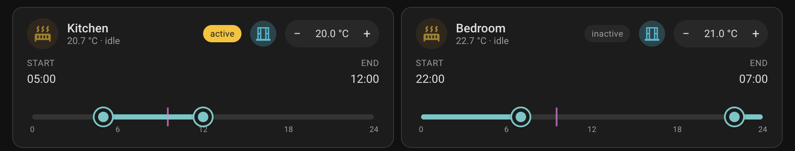

# Heating Window Slider Card for Home Assistant


> **Personal project** — built for a specific Better Thermostat installation. The card and automation only depend on a `climate` entity that accepts `set_temperature`, so they work with any climate integration; the rest of the install is generic HA. Released as-is.

[](https://hacs.xyz)

A per-room heating schedule for Home Assistant. Each room gets a card with a 24-hour shared track that holds **1 to 4 heating windows**, a target-temperature spinner, the current room temperature, and a window open/closed indicator. A single automation enforces the schedule against `climate` entities (designed for Better Thermostat, works against any climate that accepts `set_temperature`).



## What it gives you

- **1–4 heating windows per room** on a single 24h track. Heating window count is configuration only — set by the length of the JSON list in the helper (or its `initial:` default in `helpers.yaml`). To add or remove a heating window: edit the `input_text` helper value.
- **Dual-handle range slider per heating window**. Drag start and end; cyclic neighbour constraint prevents handles from passing one another (equal values are allowed for smooth touching).
- **Wrap-around for the last heating window**: if its end is earlier than its start (e.g. `22:00 → 07:00`), it renders as two fills (start→24:00 and 00:00→end). Wrap is reachable through ordinary drags — no special toggle.
- **Per-room comfort temperature** via a `+/–` spinner. The room heats to this value whenever any heating window is active.
- **Setback outside all heating windows**: configurable via `number.heating_schedule_setback` (initial value set in the wizard, default 14 °C). Adjust from a dashboard tile or read the value from external automations.
- **Active / inactive badge** — whether the current time falls inside any heating window for that room.
- **Current room temperature** in the subtitle, from a sensor you wire up.
- **Window open/closed icon** mirroring the colour theme of HA's tile cards (cyan when open).
- **`heating_paused` aware** — yields to the existing pause/resume flow with a 5 s delay so the schedule re-asserts after the snapshot restore, not against it.

## Requirements

- Home Assistant 2024.7 or later. The integration serves its card through the async static-path API that first shipped in 2024.7; the example automation uses the modern `triggers:` / `actions:` keys plus the `from_json` filter.
- One `climate` entity per room that accepts `set_temperature` — any climate integration works (Better Thermostat, generic_thermostat, MQTT HVAC, native Zigbee TRV climates, etc.). I happen to use [Better Thermostat](https://github.com/KartoffelToby/better_thermostat) over Zigbee TRVs, which is why the install notes occasionally reference it.
- Optional but recommended: per-room temperature sensor and window-opening binary sensor.

## Installation

This installs the card *and* provisions everything else — per-room heating window storage, comfort target, the schedule controller — through a normal HA config flow.

1. **HACS** → search for *Heating Schedule* → install → restart HA.
   *(Until the integration is accepted into HACS default: ⋮ → **Custom repositories** → add `https://github.com/genericJE/ha-heating-schedule`, type **Integration** → install → restart.)*
2. **Settings → Devices & Services → Add Integration → "Heating Schedule"**. The wizard asks for the number of rooms, then per room: name + climate entity (+ optional current-temperature sensor and window binary sensor) + comfort temperature + initial heating windows. The last step shows a pasteable Lovelace YAML snippet for a sections view.
3. **Settings → Dashboards → Resources → Add resource** → URL `/heating_schedule/heating-window-slider-card.js`, type *JavaScript module*. (One-time. The integration serves the card from its own static path.)
4. Paste the YAML snippet into a sections-style dashboard view.

Per room you get:

- `text.<slug>_windows` — JSON heating window list, written by the card slider.
- `number.<slug>_comfort` — comfort target, written by the card spinner.

(`<slug>` is the room name slugified — `Living Room` → `living_room`.)

You also get two hub-level entities:

- `switch.heating_schedule_pause` — pause the schedule (see [Pause](#pause) below).
- `number.heating_schedule_setback` — temperature applied outside any heating window. Seeded from the wizard's setback step; adjustable from a dashboard tile or service call. The controller re-evaluates immediately on change. External automations can read it as `{{ states('number.heating_schedule_setback') | float }}`.

The schedule controller runs inside the integration: per-minute tick + state-change listeners on the per-room text/number entities + `homeassistant.start` + the pause switch's off-transition (with a 5 s settle). It writes `set_temperature` to your climate entity when inside a heating window and the configured setback otherwise, with an idempotent guard so unchanged targets stay quiet.

## Card config reference

```yaml
type: custom:heating-window-slider-card
name: Bedroom                              # optional, defaults to entity friendly name
windows_entity: input_text.x               # required, JSON array of HH:MM pairs
comfort_entity: input_number.y             # required, comfort temperature
climate_entity: climate.bedroom_heating    # optional, drives subtitle + heating tint
current_temp_entity: sensor.bedroom_temp   # optional, current room temp in subtitle
window_entity: binary_sensor.bedroom_open  # optional, open/closed icon (cyan when open)
step_minutes: 5                            # optional, slider snap (default 5)
```

## How the schedule logic works

The automation runs every minute (`time_pattern: '/1'`) and also fires on:

- state change of any `input_text.heating_windows_<room>` (slider drag, add/remove heating window)
- state change of any `input_number.heating_comfort_<room>` (spinner click)
- state change of `number.heating_schedule_setback` (so setback edits take effect immediately)
- `input_boolean.heating_paused` off→on transitions (with a 5 s settle delay)
- `homeassistant.start`

For each room it parses the JSON heating window list and checks whether **any** heating window contains the current time. The heating-window membership math (with wrap):

```
in_window = (s < e  and s ≤ n < e)
         or (s > e  and (n ≥ s or n < e))
```

If yes → write `comfort_<room>` to the climate target. If no → write the current setback (`number.heating_schedule_setback`, default 14 °C).

Each write is guarded by `current_target ≠ desired`, so re-evaluations that match are no-ops and the TRV doesn't churn.

## Drag rules

- Each handle is clamped between its **cyclic neighbours** on the 24h circle (immediate prev / next handle clockwise).
- **Equal values are allowed** — two handles can touch but not pass.
- After every drag the schedule is **canonicalised** (sorted by start). If a drag causes a heating window to "wrap", the heating window ends up last in the list with `end < start`, and the slider renders both fill segments automatically. There's no separate wrap mode toggle.
- **Heating window count is configuration only.** The card has no `+` / `−` UI; the number of heating windows is the JSON array length in the `input_text` helper (1 to 4). To add or remove a heating window, edit the helper (Developer Tools → States, or call `input_text.set_value`).

## Pause

The integration creates one `switch.heating_schedule_pause`, owned and persisted by the integration. Toggle it from a dashboard tile, a service call, a Lovelace tap action, or any automation — the controller writes setback (default `14 °C`) to every configured climate and stops re-evaluating until you flip it back off. The setback push is intentionally delayed 2 s (`PAUSE_SNAPSHOT_DELAY_SECONDS`) so a peer `scene.create` triggered on the same edge captures pre-pause state first. On flip-off, a 5 s settle delay lets any peer cleanup automations land before the schedule re-asserts.

While pause is on, each room's slider card renders in gray with a "disabled" badge (tooltip: "heating is paused") so the dashboard reflects the schedule's actual status.

### `input_boolean.heating_paused` as an entry point

If you add an `input_boolean.heating_paused` helper, the integration mirrors it bidirectionally with `switch.heating_schedule_pause`. Flipping either side propagates to the other (a context-id guard breaks the feedback loop). That keeps the boolean as a stable entry point for buttons and automations to pause the schedule.

Example: if you take a vacation for a week and want to pause the heating schedule, add a "Vacation heating toggle" button to your dashboard:

```yaml
type: button
entity: input_boolean.heating_paused
name: Vacation heating
icon: mdi:beach
```

Tap once → boolean flips on → mirror flips the switch → integration pushes every room to setback. Anything else you've wired to the boolean (a scene snapshot, a heat-source flow-temp lowering automation, a leave-home notification, a vacation-mode cascade) keeps firing.

### Using pause from automations

The mirror means automations can target either side. Pick the one that fits the rest of your setup; the other follows automatically.

**Pause + scheduled resume.** Combine the pause flip with an `input_datetime.heating_resume_at` so a separate "resume" automation can lift the pause later. Triggering an actionable mobile notification on `zone.leave_home` (asking for a return datetime) is a clean entry point.

**Resume on a state change, not only on a clock.** A robust resume automation triggers on all of:

- `time:` at `input_datetime.heating_resume_at` (the scheduled return)
- `time_pattern:` `/5min` (catch-up if HA was down when the scheduled time fired)
- `homeassistant: start` (catch-up after a restart)
- **`state:` `input_boolean.heating_paused` from `on` to `off`** — fires when the user lifts pause manually from the dashboard, the switch tile, or another automation

The first three need an `eta ≤ now` condition; the manual-unpause trigger should fire unconditionally. Without that fourth trigger, a manual unpause runs the integration's resume but skips whatever cascade you wanted (clearing related toggles, dismissing a notification, restoring a scene).

**Snapshot scenes for restore-on-return.** If you want to remember pre-pause state and restore it on resume, snapshot a scene on the same `heating_paused: off→on` edge:

```yaml
- action: scene.create
  data:
    scene_id: heating_pause_snapshot
    snapshot_entities:
      - climate.kitchen_heating
      - climate.bedroom_heating
      # ...
```

The integration's 2 s pause-on setback delay is sized to let this snapshot land before climate targets are lowered.

### Pitfalls

Things that won't work the way you might expect.

1. **Don't drive climate entities directly while paused.** The integration writes setback every minute (idempotently — but as soon as your value differs from setback, it rewrites). To run rooms warmer during a pause, edit `number.<room>_comfort` and lift the pause; the integration writes comfort immediately on resume.
2. **Manual climate setpoints don't survive a pause cycle.** On resume, the integration re-evaluates from `text.<room>_windows` + `number.<room>_comfort` + the configured setback and overrides whatever the climate is set to. If you need pre-pause targets back, snapshot a `scene.heating_pause_snapshot` on the pause-on edge and restore it on resume.
3. **Don't trigger your resume automation only on time-based conditions.** Without a `heating_paused: on→off` trigger, a user who lifts pause early via the switch or boolean will see heating come back but anything else gated on that automation (related toggles, robot/presence cascades, return-home notifications) will stay engaged until the original scheduled time arrives.
4. **The schedule silently skips climates in `hvac_mode: off`.** A user-disabled climate is treated as authoritative; the integration won't bring it out of off. Set it back to `heat` (or your platform's equivalent) for the schedule to apply.
5. **The schedule yields to Better Thermostat's window-open frost protect.** When a climate reports `attributes.window_open: true`, the integration skips its writes for that room and lets the underlying platform hold its frost target. Comfort writes resume automatically once the window closes.
6. **Don't rename `input_boolean.heating_paused`.** The integration's mirror is hardcoded to that exact entity_id (`EXTERNAL_PAUSE_BOOLEAN` in `custom_components/heating_schedule/const.py`). Rename it and the sync silently breaks; edit the constant to match if you need a different name.
7. **The integration's setback survives in `number.<room>_comfort`, not in a snapshot.** The setback temperature is hub-scoped (`number.heating_schedule_setback`, seeded from the wizard, default `14 °C`); the comfort target is per-room and editable from the card spinner. If you change a room's comfort while paused, the new value is what wins on resume — there's no "remember the comfort I had before the pause."

**Tl;dr**: anything you want preserved across a pause goes in a scene snapshot; anything you want changed by the pause goes in the integration's own state; everything else stays out of the climate entities while pause is on.

### Legacy YAML install: `Apply Heating Pause` / `Resume Heating on Return`

The YAML install path predates the integration. Its pause flow uses two cooperating automations:

- **Apply Heating Pause** on `heating_paused: off → on` — snapshots `scene.heating_pause_snapshot`, sets all rooms to 14 °C.
- **Resume Heating on Return** on `eta ≤ now` — turns `heating_paused` off, restores from the scene, 3 s settle, then optional Hc1DayTemp fallback.

The YAML schedule automation includes a 5 s delay on the "all rooms" branch (triggered by `heating_paused` off-transition or HA start) so Resume's scene restore lands before the schedule re-asserts. The idempotent write guard keeps things quiet when the scene's restored values already match the schedule's desired state.

If a user manually un-pauses (e.g. by tapping the Pause button), the schedule writes comfort/setback after the 5 s delay — no scene needed.

When upgrading from YAML to the integration: the integration's sync layer means both pause entities stay aligned, so the YAML automations keep firing on the boolean while the integration controller responds via the switch. You can drop the YAML schedule automation; the integration replaces it.

## Customisation

- **Comfort temperature**: per-room `input_number`. Adjust via the spinner or directly in the helper.
- **Setback temperature**: `number.heating_schedule_setback`. Adjust via a dashboard tile, a service call, or `number.set_value` from any automation.
- **Slider step**: pass `step_minutes: 15` (or other) on the card to coarsen the granularity. Default is 5.
- **Comfort defaults per room**: in `helpers.yaml`, the `initial:` keys set the value used the first time a helper loads.
- **Default heating windows**: also via `initial:` in `helpers.yaml`. The card and automation will follow.

## Not in scope

- Open-window detection — your climate integration may handle that locally (Better Thermostat does). The card just surfaces window state for awareness.
- HVAC mode switching (heat / off / auto). The automation writes only `set_temperature`; mode stays where you put it.
- Holidays, geo fencing, presence-aware adjustments. Hook these into the existing pause flow rather than the schedule.

## License

MIT

If anything here ends up being useful to you and you feel like saying thanks, my PayPal is https://paypal.me/genericJE. Truly no expectation either way, just leaving the option here in case.
